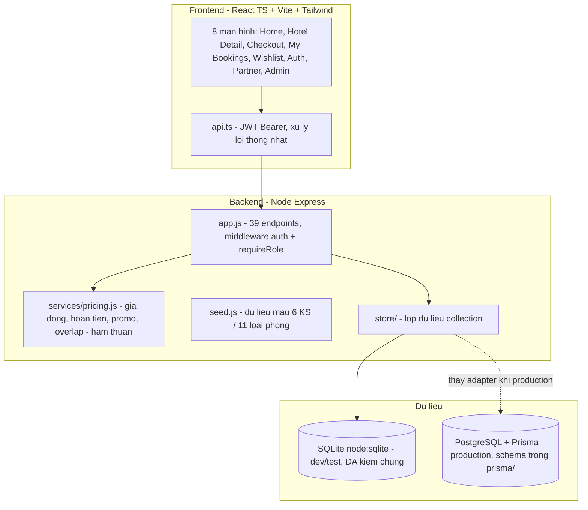

# Architecture — Hotelora

## Quyết định thiết kế

1. **Logic tiền là hàm thuần** (`services/pricing.js`): giá động, hoàn tiền, validate mã giảm giá, kiểm tra trùng khoảng ngày — không phụ thuộc DB, unit test trực tiếp và dùng lại trong route.
2. **Snapshot tại thời điểm đặt:** giá từng đêm và chính sách hủy được sao vào booking. Đối tác đổi giá/chính sách sau đó không làm thay đổi đơn đã đặt — đây là yêu cầu nghiệp vụ bắt buộc của sàn đặt phòng.
3. **Chống overbook bằng đếm phòng hiệu lực:** số phòng bị chiếm = tổng `rooms` của các booking `CONFIRMED`, `CHECKED_IN`, hoặc `PENDING_PAYMENT` còn trong thời gian giữ (hold) mà khoảng ngày giao nhau theo quy tắc nửa mở `[checkin, checkout)` — khách trả phòng buổi sáng không chặn khách nhận phòng buổi chiều cùng ngày.
4. **Phân quyền 2 lớp:** middleware vai trò (GUEST/PARTNER/ADMIN) + kiểm tra sở hữu (`partnerId === user.id`) cho mọi thao tác đối tác; admin sàn không sửa nội dung khách sạn, chỉ duyệt.
5. **Hoa hồng sàn 10%** tách ngay trong giao dịch thanh toán (`commission`, `partnerAmount`) để báo cáo đối tác và admin dùng chung một nguồn số liệu.
6. **Lớp dữ liệu dạng collection** giúp bản dev/test chạy trên SQLite nhúng; bản production thay bằng Prisma/PostgreSQL với cùng mô hình (xem DATABASE_DIAGRAM và `prisma/schema.prisma`).
