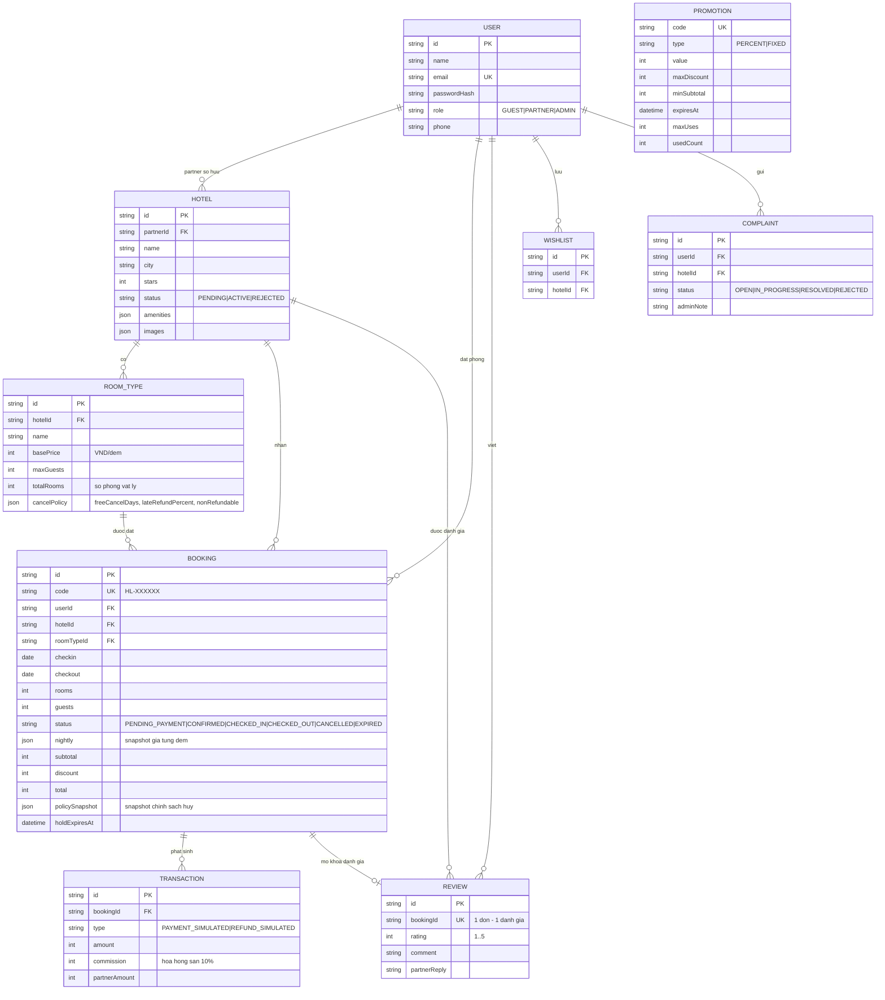

# Database Diagram — Hotelora

Mô hình dữ liệu (tương ứng 1-1 giữa lớp SQLite dev/test và `prisma/schema.prisma` cho PostgreSQL):

## Ghi chú toàn vẹn

- `Booking.code` duy nhất; `Review.bookingId` duy nhất (mỗi đơn một đánh giá).
- `Wishlist (userId, hotelId)` duy nhất.
- Ràng buộc chống trùng phòng thực thi ở tầng service bằng đếm booking hiệu lực theo khoảng ngày (xem ARCHITECTURE) vì phụ thuộc cả trạng thái và thời gian giữ phòng — không thể biểu diễn bằng UNIQUE đơn thuần.
