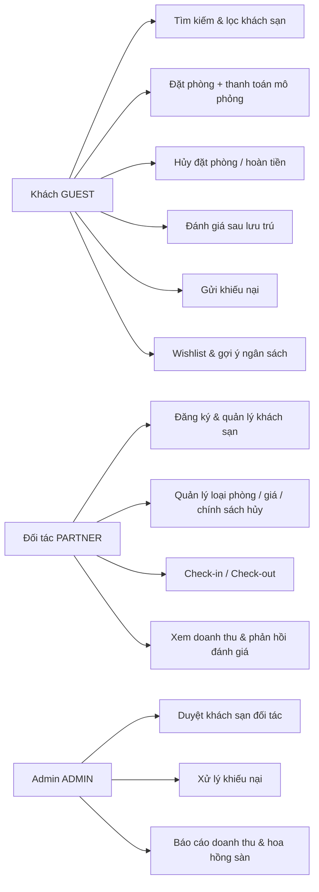

# Use Case — Hotelora

## Đặc tả các use case chính

### UC2 — Đặt phòng
- **Tiền điều kiện:** đã đăng nhập; khách sạn ACTIVE.
- **Luồng chính:** chọn loại phòng + ngày + số phòng/khách + mã giảm giá (nếu có) → server kiểm tra tồn phòng theo khoảng ngày → tính giá từng đêm (snapshot) → tạo booking `PENDING_PAYMENT`, giữ phòng 15 phút → khách thanh toán mô phỏng → booking `CONFIRMED`, ghi giao dịch kèm hoa hồng 10%.
- **Ngoại lệ:** hết phòng → 409; mã giảm giá hết hạn/dưới tối thiểu → 400; quá sức chứa → 400; hết thời gian giữ phòng khi thanh toán → 410 và booking chuyển `EXPIRED`.

### UC3 — Hủy đặt phòng & hoàn tiền
- **Luồng chính:** khách xem trước mức hoàn (refund-preview) → xác nhận hủy → server tính hoàn theo snapshot chính sách: trong mốc miễn phí hoàn 100%, hủy trễ hoàn theo % cấu hình, loại không hoàn hủy hoàn 0% → ghi giao dịch `REFUND_SIMULATED`, booking `CANCELLED`.
- **Ngoại lệ:** booking đã check-in/đã hủy → 400.

### UC7/UC11 — Đăng ký đối tác & duyệt
- Đối tác tạo khách sạn ở trạng thái `PENDING` (không xuất hiện trong tìm kiếm công khai) → admin duyệt thành `ACTIVE` hoặc `REJECTED`.

### UC9 — Check-in / Check-out
- Chỉ đối tác sở hữu khách sạn mới thao tác được (403 nếu không phải). Check-in từ `CONFIRMED` → `CHECKED_IN`; check-out → `CHECKED_OUT` (mở quyền đánh giá cho khách).
